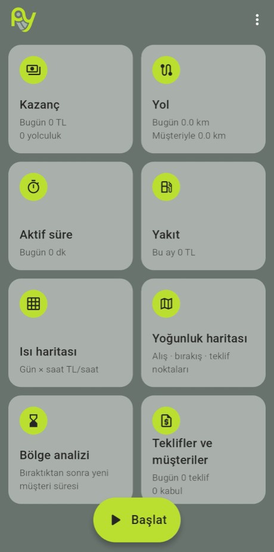
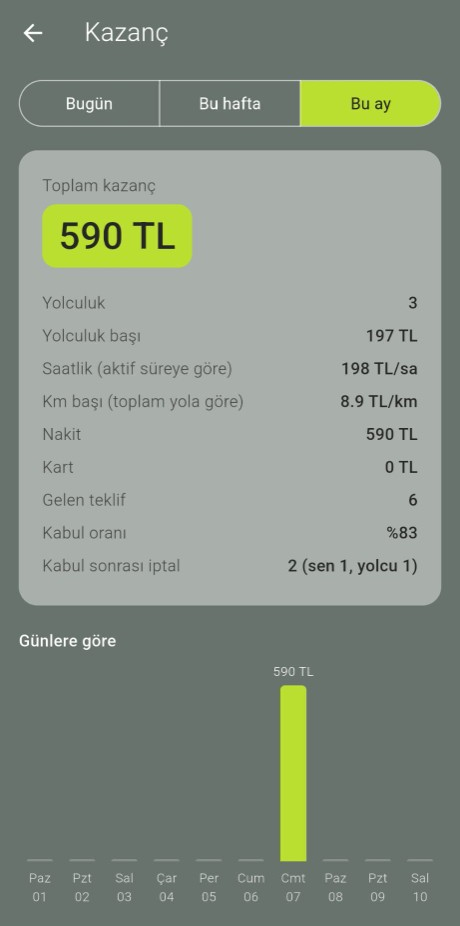
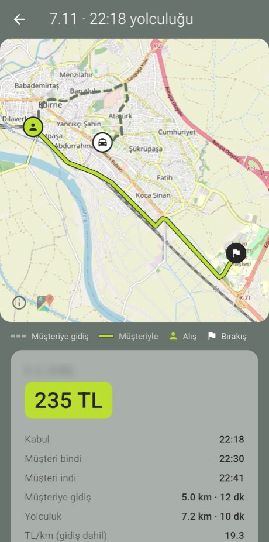
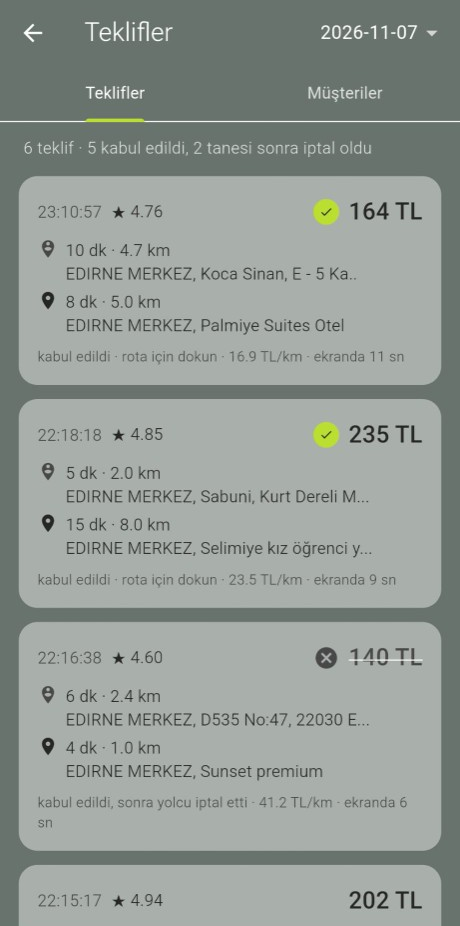
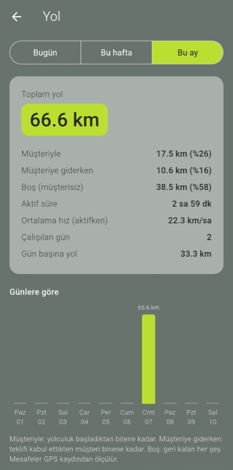
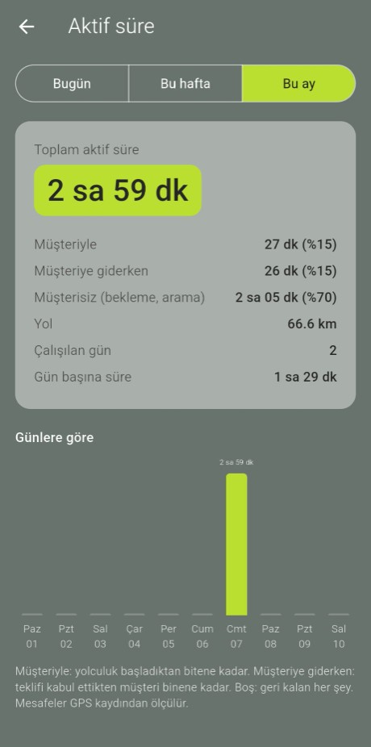

<p align="center">
  
</p>

<h1 align="center">PY Stats</h1>

<p align="center">
  Martı TAG sürücüleri için kazanç, yol ve süre istatistikleri.<br>
  Martı ekranını ve GPS'i kendiliğinden kaydeder; elle hiçbir şey girmen gerekmez.
</p>

<p align="center">
  <a href="../../releases/latest"><b>APK'yı indir</b></a>
</p>

<p align="center">
  
  
  
</p>
<p align="center">
  
  
  
</p>

## Neler gösterir

- **Kazanç:** Günlük, haftalık ve aylık toplam; yolculuk başı, saatlik ve km başı kazanç; nakit / kart ayrımı.
- **Yolculuklar:** Her yolculuğun haritada rotası: müşteriye gidiş yolu, müşteriyle gidilen yol, alış ve bırakış noktası.
- **Teklifler ve müşteriler:** Gelen her teklif, kabul oranı, kabul sonrası iptaller (sen mi, yolcu mu iptal etti) ve müşteri geçmişi.
- **Yol:** Müşteriyle, müşteriye giderken ve boş geçen km.
- **Aktif süre:** Müşteriyle, müşteriye giderken ve beklerken geçen süre.
- **Yakıt:** Girdiğin yakıt masraflarına göre kazanç / yakıt oranı.
- **Isı haritası:** Hangi gün ve saatte saat başı ne kazandığın.
- **Yoğunluk haritası:** Alış, bırakış ve teklif noktalarının haritada yoğunluğu.
- **Bölge analizi:** Bir bölgede müşteri bıraktıktan sonra yeni müşteriyi ne kadar sürede bulduğun.

## Kurulum

1. [Son sürümden](../../releases/latest) `PY_Stats.apk` dosyasını telefona indir ve aç. Telefon izin isterse "bu kaynaktan yüklemeye izin ver" seçeneğini aç.
2. Uygulamayı aç, sağ üstteki **⋮ > Ayarlar ve kurulum** sayfasındaki adımları sırayla yap:
   - Konum ve bildirim izni ver.
   - **Kısıtlı ayarlara izin ver:** APK ile kurulan uygulamalarda erişilebilirlik anahtarı gri gelir. Ayarlar > Uygulamalar > PY Stats > sağ üst ⋮ > "Kısıtlı ayarlara izin ver".
   - **Ekran okuyucuyu aç:** Ayarlar > Erişilebilirlik > İndirilen uygulamalar > "PY Stats - Martı ekran okuyucu".
   - Xiaomi, Oppo gibi telefonlarda otomatik başlatmayı aç ve pil kısıtlamasını kaldır; yoksa telefon uygulamayı arka planda kapatabilir.
3. İşe başlarken ana sayfadaki **Başlat** düğmesine bas, Martı TAG'i kullanmaya devam et.

Android 8.0 ve üstü gerekir.

## Gizlilik

- Tüm kayıtlar yalnızca telefonunda, uygulamanın kendi klasöründe tutulur. Hiçbir veri bir sunucuya gönderilmez.
- Ekran okuyucu yalnızca Martı TAG ekranlarını kaydeder; diğer uygulamalar, bildirim paneli ve telefon numaraları kaydedilmez.
- İnternet yalnızca harita karolarını [OpenStreetMap](https://www.openstreetmap.org/copyright)'ten indirmek için kullanılır.

## Geliştirme

Flutter 3.27 ile yazıldı. Android tarafı (erişilebilirlik servisi, ekran okuma, GPS kaydı) `android/app/src/main/kotlin` altında.

```bash
flutter pub get
flutter test
flutter build apk --release --target-platform android-arm64
```

`test/fixtures` altındaki kayıtlar anonimleştirilmiştir: yolcu baş harfleri değiştirildi, GPS noktaları gerçek konumdan uzağa kaydırıldı.

---

PY Stats bağımsız bir projedir; Martı ile bir bağlantısı yoktur.
